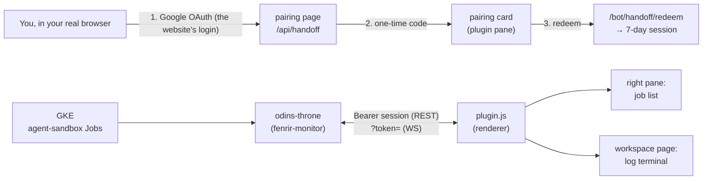

# Odin's Throne — Hermes Desktop Plugin

**Hlidskjalf inside Hermes.** The [Odin's Throne](https://github.com/declanshanaghy/fenrir-ledger)
monitor for GKE agent-sandbox Jobs, ported into the Hermes desktop app as a
first-class plugin:

- **Right pane** — the job list (SessionCards, namespace selector, WSS badge,
  theme switcher, Odin himself), docked beside the conversation.
- **Middle pane** — the log terminal (streaming JSONL, tool blocks, Norse
  tablets, verdict inscriptions) as a workspace page at `/odins-throne`.
- Same Norse pixels (the full 3,230-line theme, scoped to the plugin's own
  surfaces), same behavior (live jobs push, pin cache, Ragnarök, downloads,
  fixture speed controls, error tablets) — the UI is **vendored, not rewritten**.



## Layout

```
plugin.yaml              # manifest (unified plugin package)
__init__.py              # agent half — registers nothing yet
desktop/plugin.js        # BUILT single-file desktop half (committed for install)
src/
  entry.tsx              # register(ctx): pane + route + nav + ⌘K commands
  pane.tsx / page.tsx    # the two surfaces (Sidebar / LogViewer)
  App.tsx (ui/)          # StoreBridge — the ported App publishes to src/store.ts
  upstream.ts            # upstream URL config + OAuth-only otFetch relay
  settings.tsx           # first-run "Bind the Bifröst" dialog (⌘K)
  ui/                    # vendored from fenrir-ledger/development/odins-throne/ui
  assets/profiles/       # agent portraits (inlined as data URLs at build)
build/build.mjs          # esbuild + CSS scoping; --watch --live for dev
```

## Install

```bash
hermes plugins install declanshanaghy/odins-throne-hermes
# desktop half is opt-in by design — flip it on:
#   Hermes desktop → Capabilities → Plugins → Odin's Throne
```

Then pair once: click **"Sign in with Google"** on the pane. Google's
embedded-browser policy makes in-app Google logins impossible (it blocks the
credential step inside any webview), so the login runs where Google wants it
— your real browser:

1. The pane opens **your browser** at the monitor's pairing page — behind the
   website's own Google OAuth. No Google login ⇒ no code.
2. The page shows a one-time 8-char code (5-minute TTL, single use).
3. Type it into the pane → the plugin redeems it for a signed, user-scoped
   session (7 days) and the jobs stream. When it expires, the pairing card
   simply returns.

> **There is no other way in.** No Google login, no code, no data — and no
> standing credential either. The only setting is the upstream URL (⌘K →
> "Odin's Throne: Configure upstream"), overridden for local dev servers
> (`pnpm dev` in `development/odins-throne`, which run without
> oauth2-proxy). Server side: `src/handoff.ts` (fenrir-ledger #2377).

## Dev loop (live reload)

```bash
npm install
npm run dev
```

esbuild watches; every save rebuilds `desktop/plugin.js` and mirrors it into
`~/.hermes/desktop-plugins/odins-throne-hermes/plugin.js`, which the desktop
app hot-reloads within seconds — **no app restart, no reload command needed**.
Set a different upstream URL in the settings dialog to point at a local
monitor.

Gates: `npx tsc --noEmit` (type check) and `npm run build` (bundle must
build). Before committing UI changes, run `npm run build` so the committed
`desktop/plugin.js` matches `src/`.

## Deliberate deviations from the SPA

- The pane sash (host) resizes the job list — the browser's in-app drag handle
  is gone; compact/normal/extended display modes react to pane width instead.
- Odin's light/dark theme scopes to the plugin's own surfaces, not the window.
- Modals/toasts overlay the app window from the pane (fixed positioning).
- Path params don't exist in the app router — the selected session travels
  via shared module state; `/odins-throne` is a single route.

## Source of truth

The SPA lives in
[`fenrir-ledger/development/odins-throne`](https://github.com/declanshanaghy/fenrir-ledger);
this repo vendors the `ui/` tree (copied, not shared — the two repos are
deliberately uncoupled, same convention as claude-todo ↔ hermes-todo). The
`/bot/*` server surface is implemented in the fenrir-ledger monitor.
Evaluation: `fenrir-ledger/plans/004-odins-throne-hermes-desktop-plugin.md`.

## License

MIT
