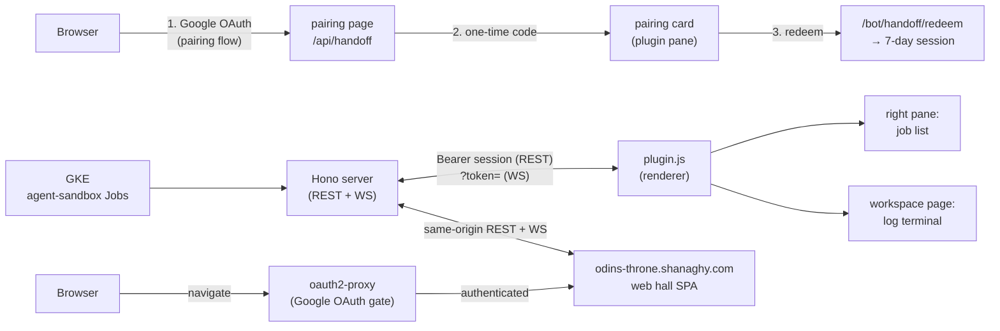

# Odin's Throne — Hermes Desktop Plugin + Live Hall

**Hlidskjalf inside Hermes.** The [Odin's Throne](https://github.com/declanshanaghy/fenrir-ledger)
monitor for GKE agent-sandbox Jobs, ported into the Hermes desktop app as a
first-class plugin — and deployed as a live web hall at
[odins-throne.shanaghy.com](https://odins-throne.shanaghy.com):

- **Right pane** — the job list as a painted tree scene (the "namespace
  lantern tree"): each namespace seated on one of the painting's own
  lanterns (its icon in the painted lantern, which lights up when active,
  and a row of small task icons beneath it — one per task), the
  open world's work hanging from it as vine-strand job cards (one-open
  accordion), plus the session count, the single light/dark theme toggle,
  the compact-view toggle, the WSS badge, and Odin himself — all in one
  right-aligned header row — docked
  beside the conversation. Clicking a
  job card opens the log terminal in a new workspace tab (or focuses it if
  it is already open). The tree is fully keyboard-operable and
  screen-reader-labelled — see
  [`knowledge/tech-designs/tree-display.md`](knowledge/tech-designs/tree-display.md).
- **Middle pane** — the log terminal (Claude Code JSONL **and** Hermes
  pretty-format streams, tool blocks, Norse tablets, verdict inscriptions) as
  a workspace page at `/odins-throne`.
- **Web hall** — the same UI as a full-page React SPA at
  `odins-throne.shanaghy.com`: tree sidebar on the left, session log panel on
  the right (draggable vertical split, localStorage-persisted width,
  double-click to reset), behind Google OAuth via oauth2-proxy.
- Same Norse pixels (the full 3,230-line theme, scoped to the plugin's own
  surfaces), same behavior (live jobs push, pin cache, Ragnarök, downloads,
  fixture speed controls, error tablets) — the UI is **vendored, not rewritten**.



## Layout

```
plugin.yaml                 # manifest (unified plugin package)
__init__.py                 # agent half — registers nothing yet
desktop/plugin.js           # BUILT single-file desktop half (committed for install)
src/
  targets/
    plugin/                 # Hermes desktop plugin adapter
      entry.tsx             # register(ctx): pane + route + nav + ⌘K commands
      pane.tsx              # Sidebar surface (right pane, host-resizable)
      page.tsx              # LogViewer surface (workspace page at /odins-throne)
      platform.ts           # adapter: theme root, WS URL, otFetch relay, assets
      pluginCtx.ts          # shared plugin context (ctx, tabOpener)
      sessionTabs.tsx       # one closeable workspace tab per session (host.openWorkspace)
      settings.tsx          # first-run "Bind the Bifröst" dialog (⌘K)
      upstream.ts           # upstream URL config + OAuth-only otFetch relay
    web/                    # full-page web hall adapter
      AppShell.tsx          # Sidebar + SessionTabPanel side-by-side, draggable split
      index.html            # Vite HTML entry point
      main.tsx              # web entry: setPlatform + ReactDOM.render
      platform.ts           # adapter: same-origin REST + WS, unscoped CSS
      tsconfig.ui.json      # tsconfig for the web target
      vite-env.d.ts         # Vite type shims
      vite.config.ts        # Vite config: proxy /api + /ws → :3001
  ui/                       # vendored from fenrir-ledger/development/odins-throne/ui
    App.tsx                 # StoreBridge — headless engine publishing to store.ts
    platform.ts             # platform interface (5 seam points, resolved at entry)
    store.ts                # pub/sub snapshot (jobs, pins, Ragnarök, namespace tree)
    components/             # shared UI components (Sidebar, LogViewer, NamespaceTree, …)
    hooks/                  # useJobs, useLogStream, useTheme, useWebSocket, …
    lib/                    # hermesFormat, jsonl, restJobs, types, …
    styles/
      index.css             # the full Norse theme (3,230 lines)
  assets/
    odin-dark.png           # Odin avatar (dark)
    odin-light.png          # Odin avatar (light)
    profiles/               # agent portrait pairs (inlined as data URLs in plugin build)
  externals.d.ts            # ambient declarations for Hermes SDK externals
build/build.mjs             # esbuild + CSS scoping; --watch --live for dev
```

## Install

```bash
hermes plugins install declanshanaghy/odins-throne-hermes
# desktop half is opt-in by design — flip it on:
#   Hermes desktop → Capabilities → Plugins → Odin's Throne
```

Then pair once: click **"Sign in with Google"** on the pane. Google's
embedded-browser policy makes in-app Google logins impossible (it blocks the
credential step inside any webview), so the login runs where Google wants it
— your real browser:

1. The pane opens **your browser** at the monitor's pairing page — behind the
   website's own Google OAuth. No Google login ⇒ no key.
2. The page shows a signed, user-scoped pairing key (click to copy).
3. Paste it into the pane → **Pair** → the jobs stream. It lasts 7 days;
   when it expires the pairing card simply returns.

The key is minted directly by the Google-authenticated page and verified
statelessly by every monitor replica (HMAC over a shared secret) — nothing is
stored server-side, so it works across the deployment's multiple pods.

> **There is no other way in.** No Google login, no key, no data — and no
> standing credential either. The only setting is the upstream URL (⌘K →
> "Odin's Throne: Configure upstream"), overridden for local dev servers
> (`pnpm dev` in `development/odins-throne`, which run without
> oauth2-proxy). Server side: `src/handoff.ts` (fenrir-ledger #2377).

## Dev loop (live reload)

```bash
npm install
npm run dev
```

esbuild watches; every save rebuilds `desktop/plugin.js` and mirrors it into
`~/.hermes/desktop-plugins/odins-throne-hermes/plugin.js`, which the desktop
app hot-reloads within seconds — **no app restart, no reload command needed**.
Set a different upstream URL in the settings dialog to point at a local
monitor.

Gates: `npx tsc --noEmit` (type check) and `npm run build` (bundle must
build). Before committing UI changes, run `npm run build` so the committed
`desktop/plugin.js` matches `src/`.

## Web target (Vite)

The same `src/ui/` core also builds as the full-page web hall:

```bash
npm run build:web   # tsc (web program) + vite build → dist-ui/
npm run dev:web     # vite dev server on :3002, /api + /ws proxied to :3001
```

`dist-ui/` holds the serving bundle (index.html + hashed assets + the
`/profiles/*.png` portraits from `src/assets/`, which the web adapter's
same-origin avatar URLs resolve against). CSS ships unscoped — on the web
the page owns the document; the esbuild `:root` → `.odins-throne-root`
scoping applies only to the plugin bundle.

The web hall layout (`AppShell.tsx`): tree sidebar on the left, session log
panel on the right. The vertical split is draggable with the divider handle;
the sidebar width is localStorage-persisted and double-click on the divider
resets to default (300 px). Minimum sidebar width is 200 px; maximum is 50%
of the viewport.

## Live hall

**`odins-throne.shanaghy.com`** — the production web hall.

- `/healthz` → `200 OK` (unauthenticated health check)
- `/` and all app routes → `403` via oauth2-proxy if not authenticated
- Behind Google OAuth (oauth2-proxy); authenticated users land at the job tree

This is the only hall: the plugin's `DEFAULT_UPSTREAM_URL` points here, and
the old fenrir-ledger dev hall (`odins-throne.fenrirledger.com`) was retired
by the exodus epic — its DNS resolves but nothing listens. Panes that still
carry the old URL as an override show every realm as "summary unavailable";
re-point them via ⌘K → "Odin's Throne: Configure upstream".

## Deploy pipeline

`.github/workflows/deploy.yml` — triggered on every push to `main`
(or manually via `workflow_dispatch`):

1. **Build + push image** — Docker builds the Hono server + React web bundle
   into a single image (`odin-throne`), pushed to Artifact Registry
   (`{region}-docker.pkg.dev/{project}/fenrir-images/odin-throne`) tagged by
   commit SHA and `:latest`.
2. **Helm deploy** — `helm upgrade --install odin-throne
   ./infrastructure/helm/odin-throne --namespace=odins-throne` — rolls the new
   image to GKE Autopilot (`odins-throne` namespace). Pre-deploy steps sync
   oauth2-proxy secrets and app secrets into the namespace from GitHub Secrets.
   Fail-closed guards: deploy aborts if `ODINS_THRONE_BOT_TOKEN` or
   `ODINS_THRONE_HANDOFF_SECRET` are absent.

Auth is **keyless** — Workload Identity Federation; no GCP service-account key
is stored in GitHub Secrets. Required secrets: `GCP_PROJECT_ID`,
`GCP_REGION`, `GKE_CLUSTER_NAME`, `ODINS_THRONE_CLIENT_ID`,
`ODINS_THRONE_CLIENT_SECRET`, `ODINS_THRONE_BOT_TOKEN`,
`ODINS_THRONE_HANDOFF_SECRET`, `OAUTH2_PROXY_COOKIE_SECRET`.

## Session log formats

The log terminal parses **both harnesses'** output into the same structured
entries — agent bubbles, tool batches, warnings, the decree tablet and the
verdict inscription:

- **Claude Code** — stream-JSONL (`src/ui/lib/jsonl.ts` → `useLogStream`).
- **Hermes** — pretty-format sessions (`☤ Hermes` turns, `💻 $`/`✗ $`
  terminal calls, `📖 Read`, `✍️ Write`/`🔧 Patch` with `│` diffs,
  `🔎 Searching tools`, `📋 Plan`; the duplicated `Query:` prompt echo is
  suppressed) via the line-oriented state machine in
  `src/ui/lib/hermesFormat.ts`, activated by the
  `=== Starting Hermes Agent ===` entrypoint header. Unknown lines fall back
  to dimmed raw text — a Hermes format change degrades to the old rendering,
  never to a blank pane. The decree parser also re-inserts the line breaks the
  Hermes harness sometimes eats, so the glued one-line decree
  (`…#9VERDICT: DONEPR: …`) still parses canonically.

Regression guard: `test/hermes-stream.mjs` replays a synthetic Hermes session
through the real hook (from the built bundle, same bytes the desktop loads)
and asserts the structured entries end to end.

## Deliberate deviations from the SPA

- **Compact-view toggle** — the header bar carries a `«`/`»` button that
  pins the job list to compact mode regardless of pane width (localStorage-
  persisted). Width-derived auto-compact still kicks in below 240 px when the
  manual override is off. (#59)
- **Single theme toggle** — one light/dark button lives in the header row,
  replacing the original multi-step dropdown. It scopes only to the plugin's
  own surfaces, not the host window. (#47)
- **Web hall split** — the web hall uses a draggable vertical divider between
  the tree sidebar (left) and the session log panel (right), with
  localStorage-persisted width and double-click reset. The plugin's pane sash
  is still controlled by the Hermes host; the in-app drag handle from the old
  SPA is absent in the plugin target. (#50, #53)
- **Display mode derivation** — in the plugin target, compact/normal/extended
  display modes react to pane width (via ResizeObserver). In the web hall,
  the sidebar width is draggable and the same modes apply to it.
- **Job card layout** — status icon leads the secondary meta line (under the
  title, beside the avatar column, so statuses scan down the left edge) instead
  of trailing on the right; padding/avatars/buttons are tighter than the SPA,
  and the meta line ellipsizes instead of wrapping (extended mode still wraps).
- **Modals/toasts** overlay the app window from the pane (fixed positioning).
- **Path params** don't exist in the app router — the selected session travels
  via shared module state; `/odins-throne` is a single route. Clicking a job
  card in the pane calls `host.openWorkspace("throne-log", …)` to open (or
  re-front) a dedicated workspace tab; on older desktop builds that lack
  `host.openWorkspace` it falls back to `host.navigate("/odins-throne")`.

## Knowledge base

The repo's shared project truth lives in [`knowledge/`](knowledge/README.md) —
read [`knowledge/INDEX.md`](knowledge/INDEX.md) first for the canonical
vocabulary (glossary, subsystems, tech-designs). The pack conventions in
`.claude/` (agents, skills) and `quality/` templates all draw their terms
from there.

## Source of truth

The SPA lives in
[`fenrir-ledger/development/odins-throne`](https://github.com/declanshanaghy/fenrir-ledger);
this repo vendors the `ui/` tree (copied, not shared — the two repos are
deliberately uncoupled, same convention as claude-todo ↔ hermes-todo). The
`/bot/*` server surface is implemented in the fenrir-ledger monitor.
Evaluation: `fenrir-ledger/plans/004-odins-throne-hermes-desktop-plugin.md`.

## License

MIT
