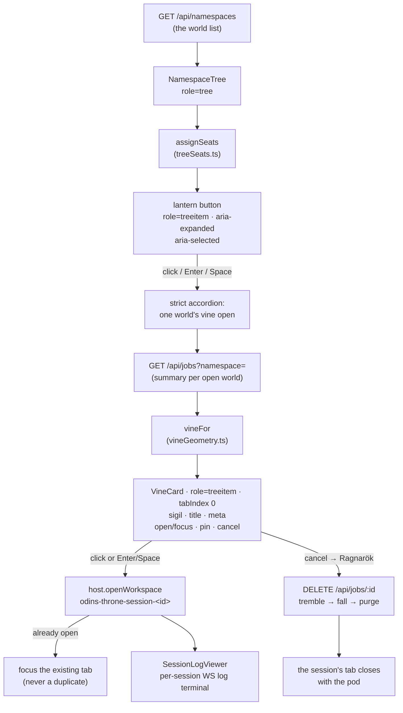

# Tree display: lanterns, vine strands, and per-session tabs

The job display is a painted tree scene (the approved contract:
`design/tree-display/tree-display-prototype.html`). Each namespace — a
"world" — is a **lantern** seated on the painting at its runtime-assigned
seat (`src/ui/lib/treeSeats.ts`: curated painted seats first, djb2-hash
fallback, terrace stack beyond the pool), with its curated shanaghy.com
icon inside (`TreeIcon`, inline glyph fallback offline) and stats berries
beside the seat.

The OPEN world's work hangs from its lantern as a **vine strand** — a
curved SVG bezier (`src/ui/lib/vineGeometry.ts`) that grows one pitch per
job, with full job cards (`VineCard.tsx`) hung along it, never overlapping,
ordered running → failed → pending → succeeded (`useJobs.sortJobs`). The
painting and lanterns stay rooted; only the vine and its cards scroll
(`.ns-tree__scroller` / `.ns-tree__canvas`).

## Interaction contract

- **Accordion** — one world's vine is open at a time. A lantern click
  selects the world (reconnects the live WS feed, persisted to the same
  localStorage key the old dropdown used) and grows its vine, retracting
  the previous strand; clicking the open lantern collapses it; reopening
  regrows it; a world gone from the API list closes its own vine.
- **Cards** — everything sits ON the card (no popups): status sigil
  (hammer/dice/raven/ring), title, session · issue # · agent meta, and the
  open/focus · pin · cancel actions.
- **Tabs** — each session stacks its own workspace tab
  (`odins-throne-session-<sessionId>`); a repeat click focuses the
  existing tab (dedupe); older hosts without `host.openWorkspace` fall
  back to a per-session route page via `host.navigate`.
- **Cancel** — Ragnarök confirm issues `DELETE /api/jobs/:sessionId`; the
  card trembles (terminating), then falls as a ghost once the pod is
  purged, and the session's tab closes with the pod.

## Accessibility

- **Keyboard operability** — lanterns are native `<button type="button">`
  (Enter/Space toggle by default); card bodies are `tabIndex 0` with
  Enter/Space opening the session's tab (the same path a click takes);
  pin and cancel are native buttons; falling ghosts ignore keys.
- **Screen-reader semantics** — `role="tree"` on the tree root,
  `role="treeitem"` + `aria-expanded`/`aria-selected` on lanterns and
  cards, `aria-label` on every lantern, card, and action (open/focus,
  pin/unpin, cancel), `aria-pressed` on the pin toggle, the strand's
  scroller labelled as the open world's tasks group.
- **Focus rings** — `:focus-visible` outlines on lanterns, card bodies and
  card actions (teal against the painting), so keyboard focus is always
  visible over the scene.

Coverage: `test/smoke.mjs` renders the built bundle against a stubbed API
and asserts the accordion (one-open, collapse, regrow, orphan-closing),
the vine (growth, hang order running → failed → pending → succeeded), the
tabs (open, focus dedupe, re-open after close), cancel → tremble →
tab-close, and the full keyboard/ARIA contract above.

Decision note: the smoke suite asserts the a11y contract against the BUILT
`desktop/plugin.js` (the bytes the desktop loads), not a component test
rig — the repo's test infrastructure is the plain-node jsdom suites in
`test/`, so no new scaffolding was invented.